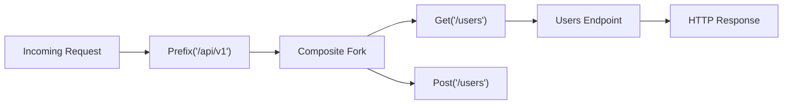

# Routing in `pyresponse`

> Pure OOP and Elegant Objects composable routing specification and guide.

In `pyresponse`, routing is not achieved through procedural framework annotations or routing decorators (such as `@app.get(...)`). Instead, routing is built by composing **`Fork`** objects into a clean, hierarchical tree.

---

## Table of Contents

1. [Core Concepts](#1-core-concepts)
2. [Routes & Methods (`Route`, `Get`, `Post`, etc.)](#2-routes--methods-route-get-post-etc)
3. [Exact Path Matching (`Path`)](#3-exact-path-matching-path)
4. [Path Prefixes & Modular Sub-Routers (`Prefix`)](#4-path-prefixes--modular-sub-routers-prefix)
5. [Regex Matching & Path Parameters (`Regex`, `PathParams`)](#5-regex-matching--path-parameters-regex-pathparams)
6. [Virtual Hosting (`Host`)](#6-virtual-hosting-host)
7. [Header-Based Routing & Versioning (`HeaderFork`)](#7-header-based-routing--versioning-headerfork)
8. [Composite Routing & Fallbacks (`Fork`, `Fallback`)](#8-composite-routing--fallbacks-fork-fallback)
9. [Guards & Middleware (`GuardedEndpoint`, `GuardedBranch`, `Cors`)](#9-guards--middleware-guardedendpoint-guardedbranch-cors)
10. [Observability & Diagnostics (`MeasuredEndpoint`, `LoggedFork`)](#10-observability--diagnostics-measuredendpoint-loggedfork)
11. [Exception Trapping & Error Mapping (`Trap`)](#11-exception-trapping--error-mapping-trap)
12. [Complete Composed Example](#12-complete-composed-example)

---

## 1. Core Concepts

Every route in `pyresponse` adheres to two core protocols:

- **`Fork`**: Evaluates an incoming `Request` and returns a matching `Endpoint` (or `MissingEndpoint`).
- **`Endpoint`**: Receives a `Request` and produces an HTTP `Response`.



---

## 2. Routes & Methods (`Route`, `Get`, `Post`, etc.)

### The `Route` Object
The `Route` object cleanly pairs an HTTP method and path with an endpoint:

```python
from pyresponse.fork import Route
from pyresponse.response import Ok, Text

route = Route("GET", "/health", lambda req: Ok(Text("healthy")))
```

### Dedicated HTTP Method Forks
`pyresponse` provides dedicated method forks for all standard HTTP methods:
- `Get`
- `Post`
- `Put`
- `Delete`
- `Patch`
- `Options`
- `Head`

#### Combined Method & Path (2-argument form)
```python
from pyresponse.fork import Delete, Fork, Get, Post
from pyresponse.response import Created, Json, NoContent, Ok

routes = Fork(
    Get("/users", lambda req: Ok(Json([{"id": 1, "name": "Alice"}]))),
    Post("/users", lambda req: Created(Json({"status": "created"}))),
    Delete("/users/1", lambda req: NoContent()),
)
```

#### Standalone Method Filter (1-argument form)
Can be nested inside any path matcher:
```python
from pyresponse.fork import Fork, Get, Path, Post
from pyresponse.response import Ok, Text

item_resource = Path(
    "/item",
    Fork(
        Get(lambda req: Ok(Text("Fetched item"))),
        Post(lambda req: Ok(Text("Created item"))),
    ),
)
```

---

## 3. Exact Path Matching (`Path`)

The `Path` fork matches the exact URI path of a request:

```python
from pyresponse.fork import Path
from pyresponse.response import Ok, Text

route = Path("/about", lambda req: Ok(Text("About PyResponse")))
```

---

## 4. Path Prefixes & Modular Sub-Routers (`Prefix`)

The `Prefix` fork strips a path prefix and delegates to child forks. This allows mounting sub-routers without repeating URL prefixes:

```python
from pyresponse.fork import Fork, Get, Post, Prefix
from pyresponse.response import Json, Ok

# Sub-router for /users
users_router = Prefix(
    "/users",
    Fork(
        Get("/", lambda req: Ok(Json(["Alice", "Bob"]))),
        Post("/", lambda req: Ok(Json({"created": True}))),
    ),
)

# Root router mounting /api/v1
app = Prefix(
    "/api/v1",
    Fork(
        users_router,
        Get("/health", lambda req: Ok(Json({"status": "healthy"}))),
    ),
)
```

---

## 5. Regex Matching & Path Parameters (`Regex`, `PathParams`)

The `Regex` fork matches URI paths using regular expressions with named capture groups. Extracted path parameters are accessed via the `PathParams` inspector:

```python
from pyresponse.fork import Regex
from pyresponse.request import PathParams
from pyresponse.response import Json, Ok

async def user_detail(req):
    user_id = await PathParams(req).param("user_id")
    return Ok(Json({"user_id": user_id}))

# Matches request method under Regex pattern:
route = Regex(r"^/users/(?P<user_id>\d+)$", Get(user_detail))
```

---

## 6. Virtual Hosting (`Host`)

Route requests based on the HTTP `Host` header (supporting domains, subdomains, and ports):

```python
from pyresponse.fork import Fork, Get, Host
from pyresponse.response import Ok, Text

api_routes = Get("/", lambda req: Ok(Text("API Domain")))
web_routes = Get("/", lambda req: Ok(Text("Web Domain")))

app = Fork(
    Host("api.example.com", api_routes),
    Host("www.example.com", web_routes),
)
```

---

## 7. Header-Based Routing & Versioning (`HeaderFork`)

Route requests based on header values (e.g. content negotiation or API versioning):

```python
from pyresponse.fork import Fork, HeaderFork
from pyresponse.response import Ok, Text

v1_endpoint = lambda req: Ok(Text("Version 1.0"))
v2_endpoint = lambda req: Ok(Text("Version 2.0"))

app = Fork(
    HeaderFork("accept", "application/vnd.company.v2+json", v2_endpoint),
    HeaderFork("accept", "application/vnd.company.v1+json", v1_endpoint),
)
```

---

## 8. Composite Routing & Fallbacks (`Fork`, `Fallback`)

The `Fork` class groups multiple branches and evaluates them in order until a match is found:

```python
from pyresponse.fork import Fallback, Fork, Get
from pyresponse.response import NotFound, Ok, Text

# Pure composite evaluating routes
routes = Fork(
    Get("/items", lambda req: Ok(Text("Items list"))),
    Get("/contact", lambda req: Ok(Text("Contact us"))),
)

# Explicit fallback decorator when no route matches
app = Fallback(
    routes,
    fallback=lambda req: NotFound(Text("Custom 404 - Not Found")),
)
```

---

## 9. Guards & Middleware (`GuardedEndpoint`, `GuardedBranch`, `Cors`)

Conditionally protect endpoints without monkey-patching or procedural hooks:

```python
from pyresponse.fork import Cors, Fork, Get, GuardedEndpoint
from pyresponse.request import Header
from pyresponse.response import BadRequest, Ok, Text

# Guard that verifies presence of an API key
def has_api_key(req):
    return "x-api-key" in dict(req.head().headers())

protected_route = Get(
    "/secret",
    GuardedEndpoint(
        target=lambda req: Ok(Text("Top secret")),
        predicate=has_api_key,
        rejection=lambda req: BadRequest(Text("Missing API Key")),
    ),
)

# CORS preflight & header wrapper
cors_app = Cors(
    protected_route,
    origins=("https://example.com",),
    methods=("GET", "POST"),
)
```

---

## 10. Observability & Diagnostics (`MeasuredEndpoint`, `LoggedFork`)

Attach timing metrics and logging to endpoints non-invasively:

```python
from pyresponse.fork import Get, MeasuredEndpoint
from pyresponse.response import Ok, Text

def record_metric(duration_seconds: float):
    print(f"Request executed in {duration_seconds * 1000:.2f}ms")

observed_route = Get(
    "/ping",
    MeasuredEndpoint(
        origin=lambda req: Ok(Text("pong")),
        tracker=record_metric,
    ),
)
```

---

## 11. Exception Trapping & Error Mapping (`Trap`)

`Trap` wraps a `Fork` or `Endpoint` and intercepts domain exceptions, converting them into structured HTTP responses:

```python
from pyresponse import BadRequest, ServerError, Trap
from pyresponse.fork import Get
from pyresponse.request import Header, HeaderNotFound, ParamNotFound
from pyresponse.response import Json, Ok

async def secure_endpoint(req):
    token = Header(req, "Authorization").value()
    return Ok(Json({"token": token}))

app = Trap(
    Get("/secure", secure_endpoint),
    traps={
        HeaderNotFound: lambda exc, req: BadRequest(
            Json({"error": f"Missing header: {exc.name()}"})
        ),
        ParamNotFound: lambda exc, req: BadRequest(
            Json({"error": f"Missing parameter: {exc.name()}"})
        ),
        Exception: lambda exc, req: ServerError(
            Json({"error": "Internal Server Error", "detail": str(exc)})
        ),
    },
)
```

---

## 12. Complete Composed Example

`pyresponse` allows endpoints to be written as first-class domain objects (the purest OOP approach) or functions:

```python
from pyresponse import (
    BadRequest,
    Created,
    Endpoint,
    Fork,
    Get,
    Json,
    Ok,
    Post,
    Prefix,
    Regex,
    Request,
    Response,
    Server,
    Text,
    Trap,
)
from pyresponse.request import (
    Json as RequestJson,
    ParamNotFound,
    PathParams,
)

# 1. Pure OOP First-Class Domain Endpoints
class UserList(Endpoint):
    """Endpoint representing user collection resource."""

    async def response(self, request: Request) -> Response:
        return Ok(Json([{"id": "1", "name": "Alice"}, {"id": "2", "name": "Bob"}]))


class CreateUser(Endpoint):
    """Endpoint handling user creation."""

    async def response(self, request: Request) -> Response:
        data = await RequestJson(request).content()
        return Created(Json({"status": "created", "user": data}))


class UserDetail(Endpoint):
    """Endpoint representing an individual user entity."""

    async def response(self, request: Request) -> Response:
        user_id = await PathParams(request).param("user_id")
        return Ok(Json({"id": user_id, "name": f"User {user_id}"}))


# 2. Composed Routing Tree
users_router = Prefix(
    "/users",
    Fork(
        Get("/", UserList()),
        Post("/", CreateUser()),
        Regex(r"^/(?P<user_id>\d+)$", Get(UserDetail())),
    ),
)

app = Trap(
    Prefix(
        "/api/v1",
        Fork(
            users_router,
            Get("/health", lambda req: Ok(Text("healthy"))),
        ),
    ),
    traps={
        ParamNotFound: lambda exc, req: BadRequest(
            Json({"error": f"Missing parameter: {exc.name()}"})
        ),
    },
)

if __name__ == "__main__":
    Server(app, host="127.0.0.1", port=8000).start()
```
